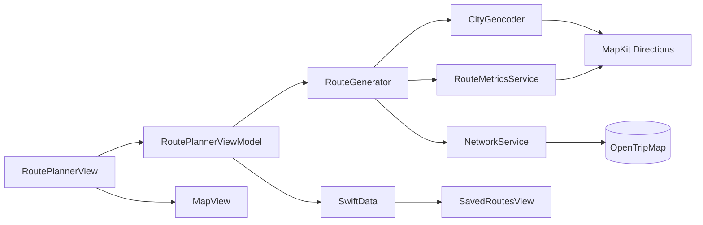

# NatureRouteAI

NatureRouteAI is an iOS app for planning multi-day nature trips. Choose a city, trip length, transport mode, and nature preferences to build a route from real OpenTripMap places.

## Current MVP

- Search for mountains, forests, lakes, waterfalls, and national parks within 50 km of a city.
- Distribute unique stops across requested days; return a partial route when there are not enough places.
- Use MapKit travel distance and estimated travel time to rank nearby candidates for walking, cycling, and driving.
- Show each day's stops with MapKit travel distance and time, and draw successfully calculated within-day route segments on a map.
- Open route directions in Apple Maps or Google Maps. Public transport directions are external; the app does not calculate transit routes or schedules.
- Save, reopen, and delete routes locally with SwiftData.
- Show user-facing search, routing, save, and delete states.

Route generation is data-driven and deterministic. It does not currently use an LLM or claim to find a “perfect” route.

## Requirements

- Xcode 26 or later
- iOS 17.0 or later
- An OpenTripMap API key for live route generation

## Local API configuration

The API key is read from `NatureRouteAI/Services/Secrets.swift`. This file is intentionally ignored by Git. For a new checkout:

1. Copy `NatureRouteAI/Services/Secrets.swift.example` to `NatureRouteAI/Services/Secrets.swift`.
2. Replace the placeholder with your OpenTripMap key.
3. Keep `Secrets.swift` out of commits.

An API key embedded in an iOS app can be extracted from the installed binary. A backend proxy with server-side key storage and request limits is required before treating the key as confidential in a public release.

## Build and test

Open `NatureRouteAI.xcodeproj`, select the `NatureRouteAI` scheme, and run on an iOS 17+ simulator or device. The `NatureRouteAITests` scheme action contains unit tests for route planning, persistence, and planner state.

```sh
xcodebuild -project NatureRouteAI.xcodeproj \
  -scheme NatureRouteAI \
  -destination 'platform=iOS Simulator,name=iPhone 16' \
  test
```

## Architecture



- **SwiftUI views** render state and handle user actions.
- **`RoutePlannerViewModel`** owns planner state and async generation, save, and cancellation actions.
- **`RouteGenerator`** searches candidates and distributes them across days.
- **`CityGeocoder`** resolves the entered city with Apple's `MKLocalSearch`.
- **`NetworkService`** downloads OpenTripMap places.
- **`RouteMetricsService`** obtains real walking, cycling, and driving metrics from MapKit; public transit remains external.
- **SwiftData models** persist routes, days, and places on-device.

## Project structure

```text
NatureRouteAI/
├── Models/
├── Services/
├── Design/
├── Features/
│   ├── Home/
│   ├── RoutePlanner/
│   ├── Saved Routes/
│   └── Map/
└── Assets.xcassets/
```

The app currently uses a dark appearance. Housing, food, facilities, taxi integrations, internal transit planning, and monetization are future product work.

## About

Built by Mykola Sudak, an iOS developer based in the Netherlands.
